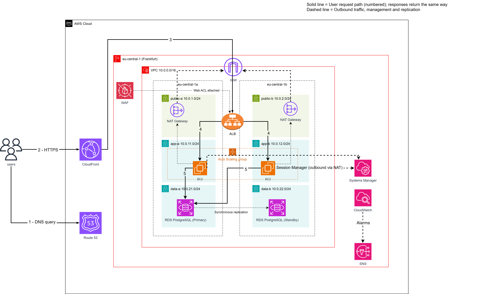

# Scalable Web Application on AWS with ALB, Auto Scaling and Multi-AZ RDS

A highly available and secure web application on AWS that scales automatically with traffic.

> Graduation project for Manara’s “AWS 2: Becoming a Solutions Architect” course. This repository documents the architecture.

## Table of contents

- [Solution overview](#solution-overview)
- [Architecture diagram](#architecture-diagram)
- [Request flow](#request-flow)
- [AWS services and why each was chosen](#aws-services-and-why-each-was-chosen)
- [Network design](#network-design)
- [Security](#security)
- [High availability and failure scenarios](#high-availability-and-failure-scenarios)
- [Scaling](#scaling)
- [Monitoring and alerting](#monitoring-and-alerting)
- [Design decisions](#design-decisions)
- [Deployment overview](#deployment-overview)
- [Limitations and future work](#limitations-and-future-work)
- [Repository structure](#repository-structure)

## Solution overview

A web application must stay available when a server or a whole Availability Zone fails, stay fast when traffic grows, and keep its servers and data away from direct internet access. Running the application on a single server meets none of these needs: one failure stops the service, extra traffic slows it down.

This solution runs the application on Amazon EC2 instances in private subnets across two Availability Zones in eu-central-1 (Frankfurt). An Auto Scaling group adds or removes instances as load changes and replaces unhealthy ones. User traffic reaches the instances only through Amazon CloudFront, which caches static files at edge locations, and an Application Load Balancer protected by AWS WAF. Data is stored in Amazon RDS for PostgreSQL with a Multi-AZ standby, so the database fails over automatically if the primary fails. Administrators reach the instances through AWS Systems Manager Session Manager, without SSH keys, open inbound ports or a bastion host.

The example workload is a simple Notes application (Node.js and PostgreSQL) in the [app/](app/) folder: a single page, static files under `/static/*`, and a small REST API under `/api/notes`. The application is stateless, so any instance can serve any request. 

## Architecture diagram



<!-- Editable source: docs/architecture.drawio -->

## Request flow

The numbers below match the numbered arrows in the architecture diagram.

1. **DNS lookup:** the browser asks Route 53 for the address of `notes.example.com`. Route 53 returns the address of the nearest CloudFront edge location. It only answers the DNS query; the request itself does not pass through it.
2. **HTTPS to CloudFront:** the browser sends the request to the edge location.
   - Requests for `/static/*` (CSS and JavaScript) are answered from the CloudFront cache. If the file is not in the cache yet, CloudFront gets it from the ALB once and keeps a copy.
   - All other requests (`/` and `/api/*`) are not cached and go to step 3.
3. **CloudFront to the ALB:** CloudFront forwards the request to the ALB through the Internet Gateway, with a secret custom header. Before the request is routed, it passes three checks:
   - The ALB security group accepts traffic only from CloudFront.
   - AWS WAF blocks common attacks such as SQL injection and cross-site scripting.
   - An ALB listener rule rejects requests without the custom header.
4. **ALB to EC2:** the ALB sends the request to a healthy instance in either Availability Zone.
5. **EC2 to RDS:** for `/api/notes`, the application reads from or writes to the RDS primary

## AWS services and why each was chosen

| Service | Role in this solution | Why this service |
| --- | --- | --- |
| Amazon VPC | Private network for all resources | Keeps servers and the database off the internet |
| Security groups + Network ACLs | Firewalls for instances and subnets | Security groups allow only the needed traffic between tiers; NACLs add a second layer at the subnet level |
| Amazon EC2 + Auto Scaling | Runs the application | Adds instances when traffic grows and replaces failed ones |
| Application Load Balancer | Spreads traffic across instances | Sends requests only to healthy instances in both AZs |
| AWS WAF | Filters requests before the ALB | Blocks common web attacks at layer 7 |
| Amazon CloudFront | Delivers the site and caches static files | Faster for users, less load on the servers |
| Amazon RDS for PostgreSQL (Multi-AZ) | Stores the data | Automatic failover to a standby in another AZ |
| Amazon Route 53 | DNS for notes.example.com | Points the domain to CloudFront |
| AWS Systems Manager (Session Manager) | Access to the instances | No SSH keys, no open ports, no bastion host |
| Amazon CloudWatch + Amazon SNS | Monitoring and alerts | Sends an email when something goes wrong |
| NAT Gateway | Outbound internet for private instances | Updates and Systems Manager access, one per AZ for high availability |

## Network design

**Region:** eu-central-1 (Frankfurt) · **VPC CIDR:** 10.0.0.0/16

| Subnet | AZ | CIDR | Type | Contains |
| --- | --- | --- | --- | --- |
| public-a | eu-central-1a | 10.0.1.0/24 | Public | ALB node, NAT Gateway |
| public-b | eu-central-1b | 10.0.2.0/24 | Public | ALB node, NAT Gateway |
| app-a | eu-central-1a | 10.0.11.0/24 | Private | EC2 instances |
| app-b | eu-central-1b | 10.0.12.0/24 | Private | EC2 instances |
| data-a | eu-central-1a | 10.0.21.0/24 | Private | RDS primary |
| data-b | eu-central-1b | 10.0.22.0/24 | Private | RDS standby |

### Route tables

| Route table | Associated subnets | Destination | Target |
| --- | --- | --- | --- |
| public-rt | public-a, public-b | 0.0.0.0/0 | Internet Gateway |
| app-rt-a | app-a | 0.0.0.0/0 | NAT Gateway (AZ a) |
| app-rt-b | app-b | 0.0.0.0/0 | NAT Gateway (AZ b) |
| data-rt | data-a, data-b | Local only | — |

- **Public subnets** route `0.0.0.0/0` to the Internet Gateway. Only the ALB nodes and the NAT Gateways live here, because they are the only resources that must be reachable from, or reach, the internet directly.
- **App subnets** route `0.0.0.0/0` to the NAT Gateway in the same Availability Zone. The instances can start outbound connections (software updates, Session Manager), but nothing on the internet can start a connection to them. Each AZ has its own NAT Gateway and route table, so if one AZ fails, the instances in the other AZ keep their outbound access.
- **Data subnets** have no internet route, only the local VPC route. The database needs to talk only to the application instances in the same VPC, and RDS is a managed service, so AWS applies patches, takes backups and handles failover without the database needing internet access. Without an internet route, even if the database were compromised, data could not be sent out of the VPC directly.

## Security

### Layers of defense

Each layer protects the application even if the layer before it fails or is misconfigured. From the edge inward:

1. **CloudFront:** the only public entry point. Serves HTTPS only and hides the ALB from users.
2. **AWS WAF:** blocks common web attacks (OWASP Top 10) and limits how many requests one IP address can send.
3. **ALB security group and listener rule:** accept traffic only from CloudFront, and only with the secret custom header.
4. **Private subnets:** the instances and the database have no public IP addresses and cannot be reached from the internet.
5. **App and database security groups:** each tier accepts traffic only from the tier in front of it.
6. **Network ACLs:** a second, subnet-level filter in case a security group is misconfigured.
7. **IAM and Session Manager:** no SSH keys or open admin ports; instances get only the permissions they need.
8. **Encryption:** data is encrypted in transit (TLS) and at rest (KMS).

### Security group chain

| Security group | Attached to | Inbound | Source | Outbound |
| --- | --- | --- | --- | --- |
| alb-sg | ALB | HTTPS 443 | CloudFront managed prefix list (`com.amazonaws.global.cloudfront.origin-facing`) | TCP 3000 to app-sg |
| app-sg | EC2 instances | TCP 3000 | alb-sg | PostgreSQL 5432 to db-sg; HTTPS 443 to the internet through NAT (updates, Session Manager) |
| db-sg | RDS | PostgreSQL 5432 | app-sg | None |

Rules use security group IDs as sources instead of IP ranges. Instances in the Auto Scaling group are created and replaced all the time, so their IP addresses change. A rule that references a security group follows its members automatically, so a new instance can reach the database as soon as it starts, and nothing else can.

There is no inbound rule for SSH (port 22) on any group. Administrators use Session Manager instead (see [Instance access and permissions](#instance-access-and-permissions)).

Security groups are stateful: return traffic for an allowed connection is allowed automatically. This is why db-sg needs no outbound rule.

### Network ACLs

Security groups are the main filter. Network ACLs add a second, subnet-level layer around the most sensitive tier, the database.

- Public and app subnets use the default network ACL, which allows all traffic. Their protection comes from the security group chain.
- Data subnets use a custom network ACL (`data-nacl`):

| Direction | Rule # | Protocol / ports | Source / destination | Action |
| --- | --- | --- | --- | --- |
| Inbound | 100 | TCP 5432 | 10.0.11.0/24 (app-a) | Allow |
| Inbound | 110 | TCP 5432 | 10.0.12.0/24 (app-b) | Allow |
| Inbound | 120 | All | 10.0.21.0/24 (data-a) | Allow |
| Inbound | 130 | All | 10.0.22.0/24 (data-b) | Allow |
| Inbound | * | All | 0.0.0.0/0 | Deny |
| Outbound | 100 | TCP 1024–65535 | 10.0.11.0/24 (app-a) | Allow |
| Outbound | 110 | TCP 1024–65535 | 10.0.12.0/24 (app-b) | Allow |
| Outbound | 120 | All | 10.0.21.0/24 (data-a) | Allow |
| Outbound | 130 | All | 10.0.22.0/24 (data-b) | Allow |
| Outbound | * | All | 0.0.0.0/0 | Deny |

Network ACLs are stateless: return traffic is not allowed automatically. When an instance connects to the database on port 5432, the reply goes back to a random ephemeral port on the instance (1024–65535), so the outbound rules must allow that range. Rules 120 and 130 keep traffic between the two data subnets open for the RDS primary and standby. If a security group rule is ever opened by mistake, this ACL still blocks any traffic to the database that does not come from the app subnets.

### AWS WAF rules


A web ACL is attached to the ALB. Rules are evaluated in priority order:

| Priority | Rule | Type | What it blocks |
| --- | --- | --- | --- |
| 1 | `AWSManagedRulesCommonRuleSet` | AWS managed | Common OWASP Top 10 attacks, such as cross-site scripting and bad request formats |
| 2 | `AWSManagedRulesKnownBadInputsRuleSet` | AWS managed | Request patterns known to exploit vulnerabilities |
| 3 | `AWSManagedRulesSQLiRuleSet` | AWS managed | SQL injection in query strings, body and cookies |
| 4 | `rate-limit-per-ip` | Rate-based | More than 1,000 requests from one IP address in 5 minutes |

AWS maintains the managed rule groups and updates them as new attack patterns appear, so no custom rules need to be written or maintained. The rate-based rule protects against request floods and brute-force attempts. The SQL injection group matters here because the application stores user input in PostgreSQL.

### Instance access and permissions

Administrators connect to the instances with AWS Systems Manager Session Manager instead of SSH or a bastion host. No inbound ports are open, no SSH keys are needed, and every session is logged.

Each instance has an IAM role with only the permissions it needs:

| Permission | Why |
| --- | --- |
| `AmazonSSMManagedInstanceCore` | Allows Session Manager access |
| Read access to `/notes-app/*` in Parameter Store | Reads the database password at startup |

The database password is stored encrypted in Systems Manager Parameter Store, not in the code. The launch template requires IMDSv2, which protects the role credentials on the instance.

### Encryption

In transit (data moving over the network is encrypted with TLS):

- User to CloudFront (arrow 2): HTTPS only. If a user opens the site with `http://`, CloudFront redirects to `https://`.
- CloudFront to ALB (arrow 3): HTTPS.
- ALB to EC2 (arrow 4): HTTP inside the VPC. This traffic never leaves the private network.
- Application to RDS (arrow 5): the PostgreSQL connection uses TLS.
- Certificates come from AWS Certificate Manager (ACM). The CloudFront certificate is created in us-east-1, as CloudFront requires; the ALB certificate is created in eu-central-1.

At rest (stored data is encrypted with AWS KMS):

- RDS storage, automated backups and snapshots.
- EBS volumes on the instances.
- The database password in Parameter Store.

## High availability and failure scenarios

| Failure | What happens | Recovery time | User impact |
| --- | --- | --- | --- |
| One EC2 instance fails | TBD | TBD | TBD |
| Application process crashes, instance still running | TBD | TBD | TBD |
| An entire Availability Zone fails | TBD | TBD | TBD |
| RDS primary fails | TBD | TBD | TBD |
| One NAT Gateway fails | TBD | TBD | TBD |
| Traffic spike | TBD | TBD | TBD |

## Scaling

<!-- Target tracking on CPU + step scaling, min / desired / max, warmup, health checks, stateless app. -->

## Monitoring and alerting

### Dashboard

<!-- Which widgets and why. -->

### Alarms

| Alarm | Metric | Threshold | Action |
| --- | --- | --- | --- |
| TBD | TBD | TBD | SNS email |

## Design decisions

| Decision | Chosen option | Alternatives considered | Reason |
| --- | --- | --- | --- |
| Application | Simple Notes app (Node.js + PostgreSQL) | TBD | TBD |
| Tiers | One app tier behind the ALB | TBD | TBD |
| Database engine | RDS for PostgreSQL, Multi-AZ | TBD | TBD |
| Region | eu-central-1 (Frankfurt) | TBD | TBD |
| NAT Gateways | One per AZ | TBD | TBD |
| WAF placement | Web ACL on the ALB | TBD | TBD |
| CloudFront origin | ALB only, /static/* cached | TBD | TBD |
| Domain | notes.example.com (placeholder) | TBD | TBD |
| Network plan | 10.0.0.0/16, six /24 subnets | TBD | TBD |
| Scaling | Target tracking on CPU + step scaling | TBD | TBD |
| Session state | Stateless | TBD | TBD |
| Instance access | Session Manager through NAT | TBD | TBD |

## Deployment overview

<!-- Ordered console steps to build the solution. -->

## Limitations and future work

- Implement the full architecture as Infrastructure as Code.
- <!-- VPC interface endpoints for Systems Manager instead of NAT -->

## Repository structure

```
.
├── README.md
├── app/
│   ├── server.js
│   ├── package.json
│   ├── schema.sql
│   ├── notes-app.service
│   └── public/
│       ├── index.html
│       └── static/
│           ├── app.js
│           └── style.css
└── docs/
    ├── architecture.drawio
    └── architecture.png
```